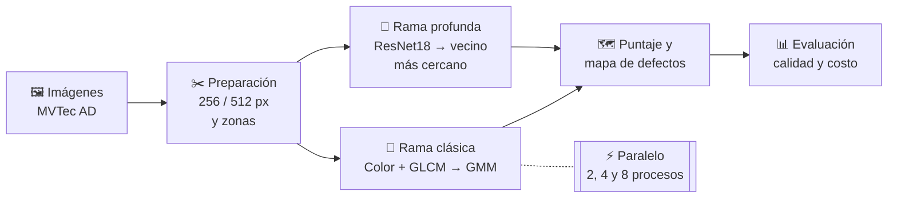

<div align="center">

# 🌰 Detección de defectos en avellanas

**Método clásico frente a aprendizaje profundo, con procesamiento paralelo**


*Proyecto final · Computación Paralela y Distribuida · 2026*

</div>

---

## 📌 Descripción

Sistema que revisa fotos de avellanas, detecta si tienen **grietas, cortes, agujeros o impresiones** y muestra **dónde** están mediante un mapa de defectos.

Comparamos dos enfoques que aprenden **solo de avellanas sanas** (detección de anomalías):

| | Método clásico | Método profundo |
|---|---|---|
| **Atributos** | Color (histograma HSV) + textura (GLCM) | ResNet18 preentrenada |
| **Detector** | Modelo de mezcla gaussiana (GMM) | Vecino más cercano |
| **Base teórica** | Sucar y Gómez, cap. 4 y 5 | Bergmann et al. (2021) |
| **Paralelismo** | ✅ Secuencial vs. 2, 4 y 8 procesos | Hilos internos de PyTorch |

## ❓ Pregunta de investigación

> ¿Qué método detecta mejor los defectos cuando cambian los datos y la resolución, cuánto cuesta cada uno y cuánto se acelera el método clásico en paralelo?

## 🏗️ Arquitectura



## 🧪 Experimentos

| ID | Qué se compara | Para responder |
|---|---|---|
| E1 | Clásico secuencial, 256 y 512 px | Línea base de tiempo y calidad |
| E2 | Clásico con 2, 4 y 8 procesos | ¿Cuánto acelera y cuándo deja de convenir? |
| E3 | ResNet18 en CPU | Calidad y costo del método profundo |
| E4 | Ambos con 10, 25, 50 y 100 % de datos | ¿Cuál resiste mejor con pocos datos? |
| E5 | Ambos a 256 frente a 512 px | Efecto de la resolución |

## 📁 Estructura del repositorio

```
deteccion-defectos-avellanas/
├── datos/            # Instrucciones para descargar el dataset (no se sube)
├── src/
│   ├── comun/        # Lectura de datos, atributos y métricas
│   ├── secuencial/   # Método clásico, versión secuencial
│   ├── paralelo/     # Método clásico, versión paralela
│   └── profundo/     # ResNet18 + vecino más cercano
├── experimentos/     # Scripts de E1 a E5
├── resultados/       # Tablas con los resultados
└── figuras/          # Gráficas y mapas de defectos
```

## ⚙️ Instalación y uso

🚧 *En construcción.*

## 📚 Dataset

[MVTec AD](https://www.mvtec.com/company/research/datasets/mvtec-ad), categoría *hazelnut*: 391 imágenes sanas de entrenamiento y 110 de prueba (40 sanas y 70 con defectos). Licencia CC BY-NC-SA 4.0; no se incluye en este repositorio.

## 👩‍💻 Equipo

| Integrante | Responsabilidad |
|---|---|
| **Yosselin Cosme Perez** | Rama clásica, versiones secuencial y paralela, experimentos de rendimiento |
| **Emmy Lopez Cueva** | Rama profunda, métricas, experimentos de calidad |

## 📖 Referencias

- Sucar, L. E. y Gómez, G. (2004). *Visión Computacional*. INAOE.
- Bergmann, P. et al. (2021). The MVTec Anomaly Detection Dataset. *International Journal of Computer Vision*, 129, 1038–1059.
