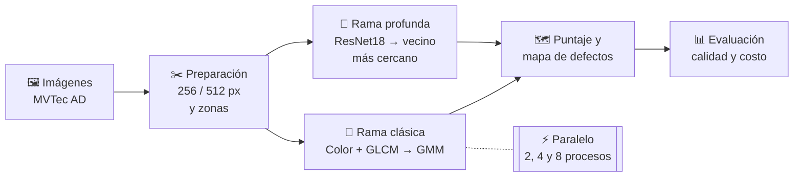
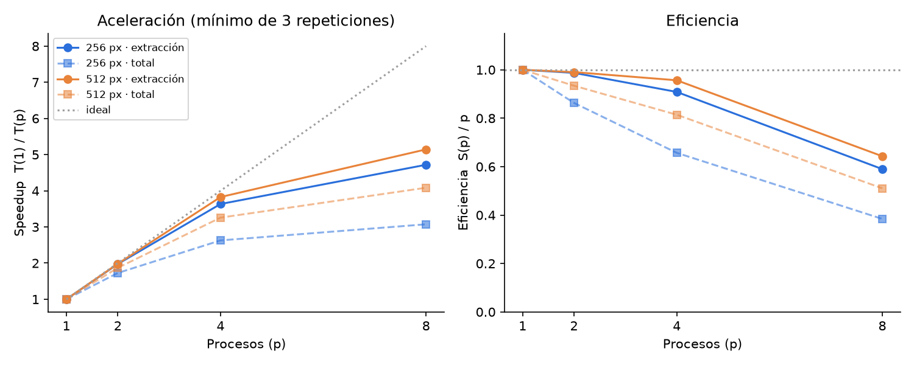
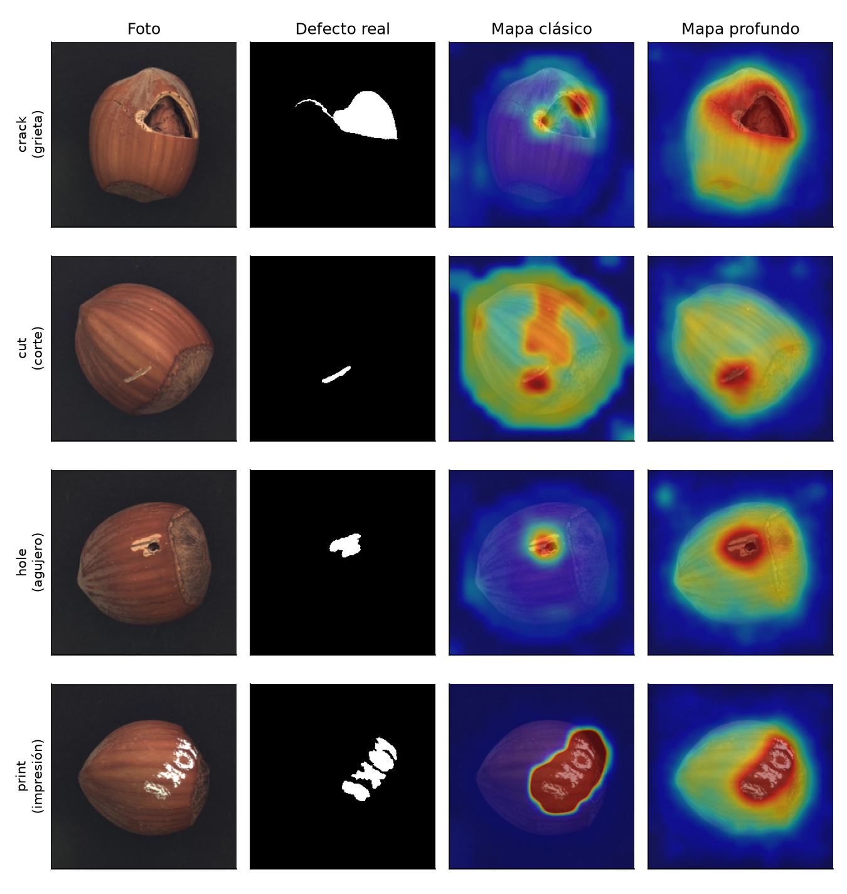

<div align="center">

# 🌰 Detección de defectos en avellanas

**Método clásico frente a aprendizaje profundo, con procesamiento paralelo**


*Proyecto final · Computación Paralela y Distribuida · 2026*

</div>

---

## 📌 Descripción

Sistema que revisa fotos de avellanas, detecta si tienen **grietas, cortes, agujeros o impresiones** y muestra **dónde** están mediante un mapa de defectos.

Comparamos dos enfoques que aprenden **solo de avellanas sanas** (detección de anomalías):

| | Método clásico | Método profundo |
|---|---|---|
| **Atributos** | Color (histograma HSV) + textura (GLCM) | ResNet18 preentrenada (capas 2 y 3) |
| **Detector** | Modelo de mezcla gaussiana (GMM) | Vecino más cercano |
| **Base teórica** | Sucar y Gómez, cap. 4 y 5 | Bergmann et al. (2021), Roth et al. (2022) |
| **Paralelismo** | ✅ Secuencial vs. 2, 4 y 8 procesos (`multiprocessing`) | Hilos internos de PyTorch |

## ❓ Pregunta de investigación

> ¿Qué método detecta mejor los defectos cuando cambian los datos y la resolución, cuánto cuesta cada uno y cuánto se acelera el método clásico en paralelo?

## 🏗️ Arquitectura



**Versión paralela:** la extracción de atributos (≈85 % del tiempo) se reparte entre procesos con `multiprocessing.Pool`. A cada proceso se le envían lotes de **rutas** de imagen (no las imágenes) y `pool.map` devuelve los resultados en orden. El ajuste del GMM queda secuencial. Se usan procesos y no hilos porque el GIL de Python impide que los hilos aceleren cálculos pesados.

## 📊 Resultados principales

### Rendimiento de la versión paralela (E1 y E2)

| Procesos | Speedup extracción 256 px | Speedup extracción 512 px | Speedup total 256 px | Speedup total 512 px |
|:-:|:-:|:-:|:-:|:-:|
| 2 | 1,98× (99 %) | 1,98× (99 %) | 1,73× | 1,87× |
| 4 | 3,63× (91 %) | 3,83× (96 %) | 2,63× | 3,26× |
| 8 | 4,72× (59 %) | 5,14× (64 %) | 3,07× | 4,08× |

*Mínimo de 3 repeticiones; entre paréntesis, la eficiencia. Las 24 ejecuciones paralelas dieron resultados idénticos a la secuencial.*



### Calidad (E3, E4 y E5)

| Método | AUROC imagen | AUROC píxel | F1 | Tiempo (256 px) |
|---|:-:|:-:|:-:|:-:|
| Clásico, 1 proceso | 0,927 | 0,957 | 0,897 | 64 s |
| Clásico, 8 procesos | 0,927 | 0,957 | 0,897 | 23 s |
| Profundo (CPU, 16 hilos) | **1,000** | **0,987** | **1,000** | 30 s |

- Con solo 39 imágenes sanas (10 %), el clásico obtiene AUROC 0,916 y el profundo 1,000.
- Pasar de 256 a 512 px no mejora la calidad y multiplica el tiempo por 2–3.



Tablas completas: [`resultados/tabla_rendimiento.md`](resultados/tabla_rendimiento.md) y [`resultados/tabla_calidad.md`](resultados/tabla_calidad.md).

## 📁 Estructura del repositorio

```
deteccion-defectos-avellanas/
├── datos/                      # Dataset (no se sube; ver datos/README.md)
├── src/
│   ├── comun/
│   │   ├── configuracion.py    # 1 hilo por proceso y modo de energía (va primero)
│   │   ├── datos.py            # Lectura de imágenes, etiquetas y máscaras
│   │   ├── caracteristicas.py  # Atributos de color (HSV) y textura (GLCM) por zona
│   │   ├── modelo_clasico.py   # GMM, mapa de defectos y flujo compartido
│   │   └── metricas.py         # AUROC, precisión, recall y F1
│   ├── secuencial/
│   │   └── clasico_secuencial.py   # Método clásico, 1 proceso (línea base)
│   ├── paralelo/
│   │   └── clasico_paralelo.py     # Método clásico, p procesos + verificación
│   └── profundo/
│       └── resnet_knn.py           # ResNet18 + vecino más cercano
├── experimentos/
│   ├── rendimiento.py          # E1 y E2
│   ├── graficas_rendimiento.py
│   ├── calidad.py              # E3, E4 y E5
│   └── graficas_calidad.py
├── resultados/                 # CSV y tablas con los resultados
└── figuras/                    # Gráficas y mapas de defectos
```

## ⚙️ Instalación y uso

### Requisitos

- Python **3.12** (probado con 3.12.10 en Windows 11)
- Unos 2 GB libres (librerías + dataset)
- No se necesita GPU

### 1. Clonar e instalar

```powershell
git clone https://github.com/yosselincosme01/deteccion-defectos-avellanas.git
cd deteccion-defectos-avellanas
py -3.12 -m venv .venv
.venv\Scripts\Activate.ps1
python -m pip install -r requirements.txt
```

> En Linux o macOS: `python3.12 -m venv .venv` y `source .venv/bin/activate`.
> Si Windows bloquea `pip.exe`, usar siempre `python -m pip`.
> Si PowerShell no deja activar el entorno: `Set-ExecutionPolicy -Scope Process -ExecutionPolicy Bypass`.

### 2. Descargar el dataset

Seguir las instrucciones de [`datos/README.md`](datos/README.md). Al final debe existir `datos/hazelnut/train`, `datos/hazelnut/test` y `datos/hazelnut/ground_truth`.

Comprobar:

```powershell
python -m src.comun.datos
```

Salida esperada: `Entrenamiento: 391 sanas` y `Prueba: 110 imágenes (40 sanas, 70 con defecto)`.

### 3. Ejecutar cada versión

Todos los comandos se ejecutan desde la raíz del proyecto, con el entorno activado.

| Qué | Comando | Tiempo aprox.* |
|---|---|---|
| Clásico, secuencial | `python -m src.secuencial.clasico_secuencial` | ~65 s |
| Clásico, paralelo (4 procesos) | `python -m src.paralelo.clasico_paralelo --procesos 4` | ~25 s |
| Paralelo + verificar igualdad con la secuencial | `python -m src.paralelo.clasico_paralelo --procesos 4 --verificar` | ~90 s |
| Profundo (ResNet18) | `python -m src.profundo.resnet_knn` | ~30 s |

Opciones comunes: `--tam 512` (resolución) y `--fraccion 0.25` (usar el 25 % de las imágenes sanas). La primera ejecución del método profundo descarga los pesos de ResNet18 (~45 MB).

*\*Intel Core i7-13620H (10 núcleos: 6 P + 4 E, 16 hilos), 32 GB de RAM.*

### 4. Repetir los experimentos

```powershell
python -m experimentos.rendimiento            # E1 y E2 (~35 min)
python -m experimentos.graficas_rendimiento
python -m experimentos.calidad                # E3, E4 y E5 (~10 min)
python -m experimentos.graficas_calidad
```

Para pruebas cortas, agregar `--rapido` a `rendimiento` o `calidad`.

**Condiciones de medición.** Los tiempos son muy sensibles a la carga de la máquina. Para resultados comparables:

- equipo conectado a la corriente y en modo de máximo rendimiento;
- cerrar navegadores, videollamadas, launchers de juegos, Docker y otros programas;
- no usar el equipo durante la medición.

Con programas abiertos, el mismo cálculo llegó a variar hasta 8 veces. Por eso se reportan 3 repeticiones y se usa el **mínimo** como estimación del costo real.

### 5. Dónde están los resultados

| Archivo | Contenido |
|---|---|
| `resultados/rendimiento.csv` | Cada ejecución de E1 y E2: tiempos por etapa, AUROC y verificación |
| `resultados/calidad.csv` | Cada ejecución de E3, E4 y E5: todas las métricas y tiempos |
| `resultados/tabla_rendimiento.md` | Resumen: mínimo, mediana, speedup y eficiencia |
| `resultados/tabla_calidad.md` | Resumen de calidad por método y condición |
| `resultados/entorno.txt` | Sistema y versiones de las librerías |
| `figuras/` | Speedup, eficiencia, desglose de tiempos, pocos datos y mapas |

Los mapas de defectos (`resultados/*.npz`, ~25 MB cada uno) no se suben; se regeneran al correr los experimentos.

## 📚 Dataset

[MVTec AD](https://www.mvtec.com/company/research/datasets/mvtec-ad), categoría *hazelnut*: 391 imágenes sanas de entrenamiento y 110 de prueba (40 sanas y 70 con defectos). Licencia CC BY-NC-SA 4.0; no se incluye en este repositorio. Detalles en [`datos/README.md`](datos/README.md).

## 👩‍💻 Equipo

| Integrante | Responsabilidad |
|---|---|
| **Yosselin Cosme Perez** | Rama clásica, versiones secuencial y paralela, experimentos de rendimiento |
| **Emmy Lopez Cueva** | Rama profunda, métricas, experimentos de calidad |

## 📖 Referencias

- Sucar, L. E. y Gómez, G. (2004). *Visión Computacional*. INAOE.
- Haralick, R. M., Shanmugam, K. y Dinstein, I. (1973). Textural Features for Image Classification. *IEEE Transactions on Systems, Man, and Cybernetics*, SMC-3(6), 610–621.
- He, K., Zhang, X., Ren, S. y Sun, J. (2016). Deep Residual Learning for Image Recognition. *CVPR*, 770–778.
- Bergmann, P. et al. (2021). The MVTec Anomaly Detection Dataset. *International Journal of Computer Vision*, 129, 1038–1059.
- Roth, K. et al. (2022). Towards Total Recall in Industrial Anomaly Detection. *CVPR*, 14318–14328.
